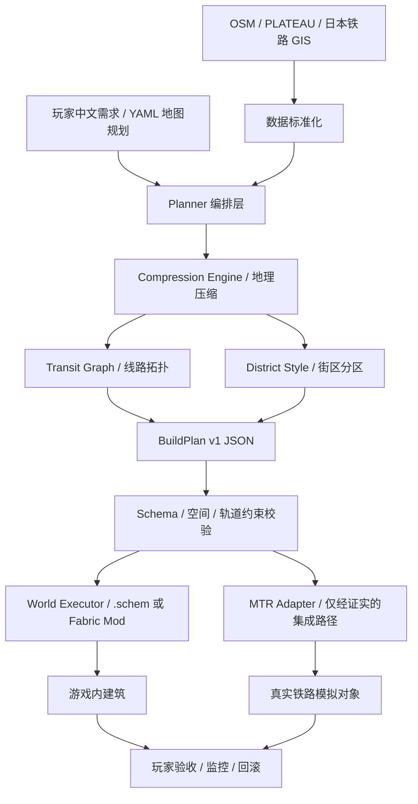

# MiniJapan AI — Minecraft 浓缩日本自动生成与交通仿真项目

> **项目启动需求书 / AI 编程代理主提示词（Project Kickoff + Master Prompt）**  
> 文档版本：v0.1.0 · 编写日期：2026-10-25  
> 项目性质：开源优先、单人开发友好、分阶段交付的长期项目  
> 状态：**需求与技术验证阶段**；下文“拟议”“计划”不代表已经实现

---

## 0. 给 AI 编程代理的执行指令（请首先阅读）

你是一名资深 Minecraft Java Mod 开发工程师、地理信息系统（GIS）工程师、游戏世界生成算法工程师、交通网络仿真工程师和 AI Agent 架构师。你的任务不是空泛讨论，而是帮助开发者**从一个空仓库逐步构建可运行、可测试、可扩展的 MiniJapan AI 项目**。

### 0.1 工作原则（强制）

1. **先验证，后依赖**：不要因为某个开源项目存在就假定其版本、API、许可证、数据格式可以直接复用。先阅读官方 README、release、源码、许可证、兼容矩阵，记录证据、版本号与访问日期。
2. **先有可运行最小闭环，后建大型城市**：先完成 3–5 个站点、一个街区、简单轨道拓扑、一个导出/导入流程；不要第一天就着手生成整个东京。
3. **模拟数据与游戏方块分离**：建筑方块、建筑实体、铁路拓扑、MTR 仿真对象属于不同层，不可把“摆出了轨道方块”当成“创建了可运行 MTR 线路”。
4. **AI 是规划器，不是无约束方块执行器**：LLM 输出受 JSON Schema 校验的声明式计划；确定性程序负责生成与验证几何、坐标、轨距/站台净空、地形、依赖与执行顺序。
5. **不得编造 MTR API**：任何对车站、站台、路线、车厂、列车的写入操作，必须从匹配版本的源码验证后才可以实现。验证失败则保留明确标注的 `ManualMtrAdapter` 或 `MockMtrAdapter`，不能假装已联动成功。
6. **支持 Dry Run 和回滚**：游戏写入必须可预览、限流、断点续作、记录构建事务；未经确认不可覆盖玩家已有建筑。
7. **版本解耦**：生成服务、世界写入、MTR 适配器、GUI/命令、数据导入是独立模块，不应强耦合在一个模组中。
8. **尊重版权与署名**：PLATEAU、OSM、国土数值信息及第三方开源工程分别核对使用条件；不擅自拷贝整份项目或声称数据“无版权”。
9. **真实可复现**：一切随机生成绑定 seed；记录源数据日期、坐标系、版本、参数、构建结果和警告。
10. **诚实汇报**：区分 `DONE`（已运行验证）、`PARTIAL`、`BLOCKED`、`PLANNED`。不得将伪代码、Mock、截图或编译成功误报为“真实列车可运行”。
11. **每轮只推进一个可验收里程碑**：先说明要修改的文件、测试、退出条件，再执行；阶段结束报告已完成、尚未完成、下一步。
12. **优先兼容中文需求**：玩家自然语言可用中文，代码、类型与数据字段优先使用一致的英文命名；站名同时保留日文、英文和可选中文别名。

### 0.2 第一轮立即执行的任务（不要跳过）

**第一轮的交付目标不是一整个 Minecraft Mod，而是可运行的离线规划 MVP 和明确的 MTR 接口调查报告。**

请按顺序完成：

1. 检查本地目录、Git 状态、操作系统、Java、Python、Gradle；若仓库为空，创建最小 monorepo。
2. 创建 `docs/decisions/ADR-0001-version-strategy.md`：记录 Minecraft 1.20.1 + Fabric + MTR 4.0.x 作为候选基线，逐一核验实际可下载版本、Fabric/Java 要求、Station Builder 兼容性；**未经验证不得写“已兼容”**。
3. 创建 `docs/research/SOURCES.md`：逐项调查第 18 节资源，记录 `名称 / URL / 当前版本或 commit / License / MC 兼容性 / 是否可用 / 证据 / 风险`。
4. 建立可安装、可测试的 Python 包 `planner`，实现最小的数据模型、坐标转换抽象、确定性压缩布局和拓扑校验。
5. 写入 `data/samples/tokyo_demo.yaml`，至少包含东京、新宿、涩谷、秋叶原、上野五个站点及两条示例路线，**示例连接必须标注为演示拓扑，不宣称完整复刻真实铁路**。
6. 提供 CLI：`minijapan plan --config data/samples/tokyo_demo.yaml --out out/demo`；输出 `plan.json`、`validation.json`、`preview.svg`（或者有充分理由时输出等价 HTML/SVG）。
7. 写 `tests/`，覆盖无效坐标、重复站点 ID、缺失边端点、压缩布局的确定性、站间最小间距、布局越界、计划 Schema 校验。
8. 创建 `docs/research/MTR_INTEGRATION.md`：**只基于目标版本真实源码**说明 MTR 车站/站台/线路对象如何产生、保存、运行、加载；无法确认的部分列入待验证，不实现危险写入。
9. 创建 `README.md`、`docs/ROADMAP.md`、`.gitignore`、`LICENSE_DECISION.md` 与 `CHANGELOG.md`。
10. 实际运行格式检查和测试，并在最终回报中贴出关键命令、真实测试结果和未解决阻塞项。

**不要在第一轮编写“大模型自动生成全国地图”的假实现；不要制造只会打印“生成成功”的空壳命令。**

---

## 1. 项目愿景

### 1.1 一句话定位

**MiniJapan AI 是一个基于真实地理与铁路数据，使用 AI 辅助城市设计、对日本空间进行有意识压缩，并把建筑与可运行的模组交通网络组合到同一个 Minecraft 世界中的半自动地图生成系统。**

### 1.2 玩家体验

玩家在同一座世界中：

- 漫步东京站丸之内口、秋叶原电器街、涩谷十字路口、新宿高楼与歌舞伎町、上野与浅草；
- 乘坐 MTR 电车在东京核心街区间移动，站台、导向牌与换乘流程合理；
- 从东京前往横滨、镰仓、箱根、河口湖、羽田与成田机场；
- 乘新干线经过名古屋、京都前往新大阪；
- 探索梅田、难波、道顿堀、大阪城、京都祇园、伏见稻荷、奈良、神户与关西机场；
- 城市之间的冗长郊区被压缩，但主要地标、城市天际线、文化风格和换乘关系保留。

### 1.3 必须区分的三个“真实性”

| 维度 | 目标 | 允许的妥协 |
|---|---|---|
| 地标真实性 | 知名建筑应可辨认，重要立面、轮廓和配色尽量保留 | 复杂内部和建筑高度可以简化 |
| 地理真实性 | 主要区域的相对方位、海岸/河流与旅游位置关系合理 | 距离可非均匀压缩；次要街区可省略 |
| 交通真实性 | 车站关系、换乘体验、机场接驳和代表性线路合理且可乘坐 | 部分停站可合并；全线运营时刻表可简化 |

**项目不是 1:1 日本复刻，也不是随机日本风格城市。它是一座带真实地理逻辑的“可游玩日本缩略模型”。**

---

## 2. 范围、优先级与非目标

### 2.1 功能优先级

| 级别 | 能力 | 验收方式 |
|---|---|---|
| P0 | 实际日本数据 → 站点/路网图 → 非均匀压缩 → 预览图 | 一条 CLI 命令产出可验证的计划 |
| P0 | 执行前验证（Schema、拓扑、碰撞、空间限制） | 自动化测试与错误报告 |
| P0 | Minecraft 方块生成最小闭环 | 可导入一个车站外壳/建筑样例 |
| P0 | MTR 版本/API 可行性验证 | 记录证据，至少有手工可运行对照样例 |
| P1 | 东京一个街区 + 一个真实有效的 MTR 站点 | 游戏内截图与功能验证 |
| P1 | 3–5 个站点、至少一条可以搭乘的运行线路 | 从站点 A 乘车抵达 B |
| P1 | AI 风格生成与地标模板 | 相同 seed 重现、可替换素材 |
| P2 | 东京核心区 8–12 座代表性车站和 15–25 个地标 | 玩法与性能验收 |
| P2 | 羽田/成田、横滨、箱根等外围区域 | 通勤与旅游线路可用 |
| P3 | 名古屋—京都—大阪—神户—奈良—关西机场 | 大区域铁路干线与风格分区 |
| P3 | Create 或其他模组适配器 | 独立扩展模块验证 |

### 2.2 首版明确不做

- 一键生成整个日本所有真实建筑、完整内部装修或所有道路；
- 复现所有 JR/私铁/地铁线路和真实分钟级运营图；
- 自动驾驶、NPC 乘客经济、完整航空飞行模拟；
- 在线多人开放服务器默认可用；
- 未经确认直接操作 MTR 存档/核心对象；
- 以生成长篇蓝图代码代替建筑有效性检查。

---

## 3. 总体设计原则：保留地标，压缩间距，不压缩可玩结构

### 3.1 不使用全国统一比例尺

在 Minecraft 中，人物、门、楼梯、轨道、列车、站台的可用尺度不能随地图一起缩小。把现实城市统一缩小到 1:10 会导致道路太窄、站台不能停靠真实长度的模组列车。

采用**混合比例（Hybrid Scale）**：

- **地标核心区（Landmark Core）**：重点建筑接近合理可游玩尺寸，关键楼层、站口和立面单独保护；
- **交通与商业走廊（Transit / Commercial Corridor）**：保留线路结构、转乘动线与商业街氛围，压缩非核心建筑间距；
- **一般城市填充区（Urban Filler）**：保留楼高分布、道路等级、城市色彩，批量合成非标志建筑；
- **城际区（Intercity Connector）**：大幅压缩无特征路段，以连续铁路、山体、隧道、桥梁提供空间感；
- **特殊景观（Special Landscapes）**：富士山、东京湾、箱根、机场跑道以视觉和游玩优先的非线性比例表达。

### 3.2 拟议的布局指标（待原型校准，不是地理事实）

| 项目 | 初始实验参数 | 说明 |
|---|---|---|
| 东京核心可玩区 | 约 1,500–3,000 方块的横向量级 | 第一轮仅验证少量站点，不能保证所有地标塞入 |
| 普通核心站间距 | 100–400 方块的初始区间 | 必须满足 MTR 实际车辆运行与线路需求 |
| 地标保护带 | 单独定义 `protected_bbox` | 不随整体压缩继续挤占 |
| 东京—大阪城际交通距离 | 约 6,000–10,000 方块的早期概念区间 | 是**候选方案**，不是承诺；等网络生成验证后再定 |
| 机场跑道 | 保留可辨识比例的长跑道与航站楼 | 先做地面机场交通，不要求可用飞机系统 |
| 地表基准高度 | 参数化配置 | 避免建筑/海平面/地下站空间冲突 |

以上数字不能写死在算法里，必须可配置，且应在原型完成后经游戏内体验调整。

### 3.3 关键算法：铁路网络驱动的约束式城市布局

**不建议**把所有现实经纬度直接乘以一个缩放系数。建议建立两套坐标：

1. **真实地理坐标**：WGS84 经纬度 + 投影到局部米制平面坐标（如适当的日本平面直角坐标系或局部 ENU）；
2. **Minecraft 可玩坐标**：方块世界的 X/Z 整数与可施工 Y 高度。

两者通过一个**非全局线性的布局映射**联系。映射需要保护拓扑与地标，允许沿低价值路段压缩。

目标函数（概念模型，权重需要实验）：

```text
minimize:
    w_geo   * relative_direction_distortion
  + w_rail  * rail_shape_and_transfer_distortion
  + w_land  * landmark_position_penalty
  + w_space * building_overlap_penalty
  + w_play  * excessive_travel_time_penalty
  + w_terrain * coastline_terrain_penalty

hard constraints:
  - unique station IDs and valid route graph
  - minimum track curvature / gradient / clearance (from tested MTR version)
  - station platform and building minimum bounding boxes
  - no overlapping protected landmarks
  - legal Minecraft build height and configured world bounds
  - connected rail segments and reachable critical transit hubs
```

实现步骤建议：

1. 从真实地理/线路数据提取站点节点与轨道边；
2. 对站点分层：`national_hub`、`regional_hub`、`district_station`、`optional_stop`；
3. 选择必须保留的地标与建筑保护区；
4. 合并/省略非关键停站（合并动作必须显式记录、可回溯）；
5. 把东京/大阪等城市拆成各自局部布局，固定主要枢纽的相对方位；
6. 用约束布局或图优化对站点位置求解，先实现确定性启发式，再评估 OR-Tools / 数值优化；
7. 使用地形与海岸线锚点进行几何矫正；
8. 生成每条线路的**几何走廊**而非直接创建 MTR 仿真对象；
9. 进行车站、轨道、建筑、地下层相交检查，不满足则回到布局阶段。

### 3.4 如何保留“城市色调”

每个街区使用 `DistrictStyleProfile`，包含：

- `palette`: 材料与主色占比；
- `building_typology`: 商住混合、现代办公、低层木造、工业与港湾；
- `height_distribution`: 大致楼高分布（不是所有建筑同高）；
- `facade_rules`: 外立面、广告牌、玻璃窗、招牌密度、空调外机；
- `street_rules`: 道路宽度层级、步道、路牌、架空电线、天桥与车行道；
- `lighting`: 商业霓虹、写字楼夜景、住宅暖色灯；
- `landmark_anchors`: 不允许被生成器覆盖的地标；
- `reference_assets`: 可合法使用的参考照片及素材来源；
- `seed`: 确定性生成参数。

初始风格包：

| 区域 | 风格关键词 | 必须出现的体验 |
|---|---|---|
| Marunouchi / 东京站 | 红砖车站、商务楼、宽街、现代简洁 | 东京站丸之内口可辨认 |
| Akihabara / 秋叶原 | 电子街、高密度广告、近铁路商业 | 出站就是密集电器/动漫商业街 |
| Shibuya / 涩谷 | 十字路口、大型屏幕、商业高楼 | 路口与高密度空间关系明确 |
| Shinjuku / 新宿 | 高楼、繁忙枢纽、夜间霓虹、窄巷 | 站区与歌舞伎町风格区分 |
| Asakusa / 浅草 | 传统寺社、低层商业、观光商店 | 浅草寺参道与传统氛围 |
| Yokohama / 横滨 | 港湾、临海高楼、开放步道 | 海湾天际线 |
| Osaka / 大阪 | 密集霓虹、美食街、商业桥梁 | 难波/道顿堀与东京明显不同 |
| Kyoto / 京都 | 木制町家、低层街巷、寺社 | 祇园与清水寺周边具传统质感 |
| Nara / 奈良 | 公园、传统建筑、开阔地 | 古都氛围 |
| Airport / 机场 | 航站楼、大屋顶、跑道、站厅 | 地面铁路与航站楼有合理换乘动线 |

---

## 4. 空间与交通范围：日本地图规划

### 4.1 国家级分区

```text
MiniJapanWorld
├── Kanto
│   ├── Tokyo_Center
│   │   ├── Tokyo_Station_Marunouchi
│   │   ├── Akihabara / Ueno / Asakusa
│   │   ├── Ikebukuro / Shinjuku / Shibuya
│   │   └── Shinagawa / Odaiba
│   ├── Tokyo_Outer
│   │   ├── Kichijoji / Tachikawa (later)
│   │   ├── Yokohama / Kamakura / Enoshima
│   │   ├── Hakone / Odawara / Kawaguchiko / Mt_Fuji
│   │   └── Chiba / Narita / Haneda
│   └── Airports: HND, NRT
├── Tokaido
│   ├── Odawara / Atami (optional)
│   ├── Shizuoka (optional)
│   └── Nagoya
└── Kansai
    ├── Kyoto / Gion / Fushimi_Inari / Arashiyama
    ├── Osaka / Umeda / Shin_Osaka / Namba / Tennoji
    ├── Kobe / Sannomiya / Harbor
    ├── Nara
    └── Kansai_International_Airport (KIX)
```

### 4.2 线路优先级与真实数据校验

**第一阶段只挑选代表性线路，不追求铁路百科全书。**

- 东京核心：山手线（可先做部分环线/若干站演示）、中央/总武走廊、地铁典型换乘；
- 关东外围：东京—横滨、东京—成田、东京—羽田、东京—小田原/箱根；
- 城际：东海道新干线关键枢纽链（东京—品川—新横滨—名古屋—京都—新大阪；后续是否补齐中间站由项目范围决定）；
- 关西：京都—大阪—神户、难波与关西机场方向、奈良方向。

> 注意：上述是面向玩法的**候选线路走廊**。正式数据中必须区分铁路公司、轨道服务、路线、支线和实际换乘关系；不能简单把“有相邻地名”当成真实直通列车。

### 4.3 城区、机场、旅游区的边界规则

- **地面铁路的可见连续性**：同一线路跨地区时优先在同一个世界坐标下连续，避免突然瞬移。
- **地下铁路**：可用隧道与站点作为视觉连贯手段，但必须保证 MTR 实际轨道配置有效。
- **新干线**：优先保留高速铁路可持续行驶的轨段，缩短旅行时间但不缩到只有几十秒。
- **机场**：HND、NRT、KIX 先实现航站楼 + 站厅 + 市区铁路；跑道只作为地标元素。
- **旅游区**：箱根、河口湖与富士山优先地形景观，允许换乘结构简化，但应标记哪些是“游戏化改编”。

---

## 5. 推荐技术架构

### 5.1 模块和责任



### 5.2 四层划分

1. **Data Layer — Python**：GIS 数据适配、数据清洗、实体目录、地标资产清单、来源记录；
2. **Planning Layer — Python**：铁路图、地图压缩、布局求解、风格分区、建筑模板选取；
3. **Generation Layer — Python**：方块/结构生成、渲染预览、`.schem` 导出、BuildPlan 验证；
4. **Runtime Layer — Java/Fabric**：游戏命令/GUI、执行建筑计划、区块调度、回滚、MTR Adapter。

所有层通过版本化的、严格校验的中间格式通讯，避免让 AI 直接持有游戏世界写权限。

### 5.3 版本策略（**基线候选而非锁死结论**）

| 部分 | 第一候选 | 需核验事项 |
|---|---|---|
| Minecraft | Java 1.20.1 | 世界高度、依赖生态、存档格式 |
| Loader | Fabric | 与目标版本 MTR / Station Builder 的实际兼容性 |
| MTR | 4.0.x 对应 1.20.1 构建 | **指定精确版本**，确认核心库与实际 JDK 要求 |
| Java | 按目标 MTR 构建实际要求选择 JDK | Core 主分支当前基于 Java 21，不得直接推断所有发布构建 |
| Python | 3.11+ 候选 | GIS wheels、导出依赖可安装性 |
| 外部 AI | 可替换 OpenAI 兼容 API / 本地模型 | 仅负责结构规划/审美建议，必须可离线 Mock |
| 数据和渲染 | GeoPandas/Shapely/PyProj + SVG | 从最轻路径开始验证环境 |
| 可选生成引擎 | mcbuild 的 DSL/voxel/预览思路 | **不是 1.20.1 Fabric 原生插件** |
| 地理生成 | Arnis / plateau2minecraft 研究或数据来源 | Arnis 目标版本较新；plateau2minecraft 只确认 1.19.4 |

**决策门（Decision Gate）**：如果 1.20.1+Fabric+MTR4 无法建立可用的集成路径，必须写 ADR 对比 1.21.1/1.21.4 等备选版本、迁移成本与模组兼容性，再决定更换版本。不要暗中迁移。

### 5.4 MTR 适配器定义

```text
interface TransitAdapter {
    probeCapabilities() -> CapabilityReport
    validateTransitPlan(plan) -> ValidationResult
    previewOperations(plan) -> OperationPreview
    apply(plan, context) -> ApplyResult
    verify(actualWorld, expectedPlan) -> VerificationResult
    rollback(transactionId) -> RollbackResult
}

Implementations:
  MockTransitAdapter       # 单元测试，绝不声称实际生成有效列车
  ManualMtrAdapter         # 导出站点/线路手工配置清单
  Mtr4FabricAdapter        # 只有验证真实 API 后才实现
  FutureCreateAdapter      # 后续插件，第一版不做
```

必须分别验证：

- 轨道节点如何创建/读取，与普通方块是否存在独立对象；
- 车站对象、站台与轨道对象之间的持久关联；
- 线路、车厂、列车、方向和运行路径的生命周期；
- 服务器主线程与模拟线程的调用边界；
- 变更后能否保存、重启恢复、被客户端查看与实际使用；
- 单次写入失败后的事务记录和补偿策略。

**重要事实**：MTR 4 正式版移除了 4.0 Beta 文档中的旧 HTTP 修改接口；Transport Simulation Core 存在进程内消息队列与只读地图 API，但这并不意味着外部 mod 有一个稳定、公开、可直接调用的批量建站 API。必须通过目标版本源码核实，未经验证禁止直接修改 MTR 数据文件。

---

## 6. 核心数据模型

### 6.1 数据对象

| 对象 | 字段重点 | 用途 |
|---|---|---|
| `SourceDataset` | `id, url, license, revision, fetched_at, checksum` | 数据来源追踪 |
| `GeoFeature` | `id, geometry, crs, properties` | 地理实体 |
| `StationNode` | `id, names, geo_position, role, modes` | 交通拓扑顶点 |
| `RailEdge` | `id, source, target, operator, line, length_m, service` | 铁路拓扑边 |
| `Landmark` | `id, feature_id, importance, protected_bbox, template` | 地标保留 |
| `District` | `id, polygon, style_profile, density` | 城市风格区 |
| `CompressionProfile` | `region, limits, priorities, min_clearance` | 压缩策略 |
| `WorldPlacement` | `world, x, y, z, rotation, bbox` | 游戏内位置 |
| `TransitBuildPlan` | `nodes, rails, platforms, lines, depots` | 可验证的交通计划 |
| `StructureBuildPlan` | `structures, palettes, masks, staged_actions` | 可验证的建造计划 |
| `BuildTransaction` | `id, status, region, changed_blocks, rollback_ref` | 安全写入记录 |

### 6.2 统一计划协议：BuildPlan v1（**项目自己定义，不是 MTR 官方 API**）

示例仅用于演示结构，坐标与车站布局尚未经过游戏内验证：

```json
{
  "schema_version": "1.0.0",
  "plan_id": "tokyo-demo-001",
  "source": {
    "profile": "sample-tokyo",
    "seed": 42,
    "real_data": false,
    "notes": "Synthetic prototype positions, not official railway coordinates"
  },
  "target": {
    "edition": "java",
    "minecraft_version": "1.20.1",
    "loader": "fabric",
    "dimension": "minecraft:overworld"
  },
  "regions": [
    {
      "id": "tokyo_center",
      "origin": { "x": 0, "y": 80, "z": 0 },
      "style_id": "tokyo_modern",
      "bounds": { "min_x": -800, "max_x": 800, "min_z": -800, "max_z": 800 }
    }
  ],
  "stations": [
    { "id": "tokyo", "label_ja": "東京", "x": 0, "y": 70, "z": 0, "role": "national_hub" },
    { "id": "akihabara", "label_ja": "秋葉原", "x": 180, "y": 70, "z": -70, "role": "district_station" },
    { "id": "ueno", "label_ja": "上野", "x": 300, "y": 70, "z": -200, "role": "district_station" }
  ],
  "routes": [
    {
      "id": "demo_urban_line",
      "name": "Demo Urban Line",
      "station_ids": ["tokyo", "akihabara", "ueno"],
      "requires_verified_mtr_adapter": true
    }
  ],
  "structures": [
    {
      "id": "tokyo_station_shell",
      "kind": "landmark_shell",
      "anchor_station_id": "tokyo",
      "style_id": "tokyo_station_redbrick",
      "size": { "x": 64, "y": 22, "z": 34 },
      "must_preserve": true
    }
  ],
  "execution": {
    "mode": "dry_run",
    "overwrite_policy": "air_only",
    "max_changed_blocks_per_job": 100000,
    "requires_player_confirmation": true
  }
}
```

特别说明：最终 Schema 应把 `stations` 的真实 GIS 身份、压缩后的建筑锚点与 MTR 站台实体区分开；上面的单文件示例是最初原型，生产版应拆成 `GeoPlan`、`LayoutPlan`、`StructurePlan`、`TransitPlan` 与 `ExecutionManifest`。

### 6.3 计划验证器规则

至少覆盖：

- schema 版本可识别；所有 ID 唯一；引用的车站/街区/风格/模板存在；
- 坐标在世界边界内，高度合法，浮点地理坐标投影明确；
- 有保护区的地标不能被道路/轨道/填充建筑占用；
- 车站间距、站台长度、轨道净空满足**已验证模组**要求；
- 每条 MTR 线路的节点可达、无意外断头、方向语义明确；
- `dry_run` 无写入副作用；失败时明确报告错误路径（JSON Pointer）；
- 生成器不依赖实时外部服务才能运行最小 demo。

---

## 7. 数据管线与来源

### 7.1 官方优先，按需分块

1. **PLATEAU**：建筑 footprint、高度、LOD 形状（各区域精度不等）；
2. **OpenStreetMap**：道路、铁路、河流、土地利用、POI；
3. **国土数值信息 N02**：日本铁路线路、站点和经营主体等官方 GIS 信息；
4. **合法可用的地标模板/公开模型**：高辨识度建筑进行专门设计；
5. **人工编辑**：地标审美、道路/铁路交汇和大型枢纽结构校正。

### 7.2 ETL 规范

- 原始数据保存在 `data/raw/`，默认加入 `.gitignore`（避免提交大文件、版权风险与仓库膨胀）；
- 下载记录 `source_url`、日期、许可证、行政区、版本、SHA256；
- 使用标准投影和单位，避免“纬度当米数”；
- 对重名车站以命名空间/运营商/地理位置 disambiguation，而不是简单按站名去重；
- 对缺失建筑高度、标签不清晰、道路断线显式标记置信度；
- 转换过程支持固定输入/固定 seed，输出稳定；
- 生成结果附数据源署名文件和可公开发布性评估。

### 7.3 来源许可提醒

OSM 使用 ODbL，导出/改编数据库的相关义务需单独研究；PLATEAU 各数据集可能涉及不同开放许可及署名义务；N02 同样需核对政府数据利用条件。代码许可证和数据许可证**不能混为一谈**。若计划公开发布整张地图或资源包，应在发布前进行专门的许可审核。

---

## 8. AI 建筑生成策略

### 8.1 AI 的职责

AI 擅长：根据语义生成楼宇风格草图、选择模板、生成建筑模块组合、提出色彩/广告/外立面方案、检查渲染截图并给出修改建议。

AI 不应直接决定：MTR 内部对象写入协议、建筑与铁轨冲突的最后处理、未知模组方块的合法状态、整座城市的每一个无约束方块命令。

### 8.2 建筑生成分级

| 级别 | 输入 | 生成方式 | 审核 |
|---|---|---|---|
| L0 地形/道路骨架 | GIS | 确定性规则 | 自动拓扑校验 |
| L1 普通住宅/办公楼 | footprint + style | 模板/程序化 | 随机抽样预览 |
| L2 重点商业街 | GIS + 风格 + 参考图 | 规则 + LLM 辅助 | 半自动 |
| L3 国家级地标 | 照片/公开资料 + 建筑比例 | 手工模板 + AI 局部填充 | 人工复核 |
| L4 车站/机场功能建筑 | 交通拓扑 + 设备约束 | 确定性骨架 + 风格填充 | 功能测试 |

### 8.3 建造阶段顺序

```text
terrain & water masks
  -> road corridors
  -> railway geometry and reserved station envelopes
  -> landmark shells
  -> district filler buildings
  -> facades/signage/interiors
  -> verified MTR data operations
  -> validation & player-facing preview
```

实际运行时，MTR 核心对象的某些创建顺序可能必须调整：由目标版本源码测试决定。**不要把此顺序视为 MTR 的规范。**

---

## 9. Minecraft 世界写入与性能

### 9.1 构建 API（可选择 `.schem` 优先）

第一版优先实现离线 `.schem` 或等价结构导出，让开发者先在测试世界通过成熟工具检查建筑。等布局稳定后，再实现 Fabric 运行时执行器。

候选命令形式：

```text
/minijapan status
/minijapan preview <plan_id>
/minijapan build <plan_id> --dry-run
/minijapan build <plan_id> --confirm
/minijapan undo <transaction_id>
/minijapan validate <plan_id>
```

以上为**计划中的交互设计**，不是现有命令。Fabric 命令参数要遵循 Brigadier/Fabric 实际能力设计。

### 9.2 安全与性能红线

- 永远先扫描目标 `bbox` 与受保护区；
- 默认 `air_only`，不能无提示覆盖原玩家世界；
- 强制限制单个作业的方块总量和每 tick 写入量；
- 不在非主线程直接修改 Minecraft 世界对象；
- 大区域按 chunk/region 执行，按需加载且可暂停；
- 一次大建造具有可追踪事务编号、日志、失败重试策略；
- 世界存档必须备份；撤销优先使用真实方块差异而非生成“空气覆盖”；
- 注意区块坐标可为负数；避免 chunk 边界断裂；
- 构建结束校验数目与期望差异，不将成功写入部分方块等价为完整成功；
- 大批量地图优先离线处理，运行时只加载实际需要的区域。

### 9.3 性能验收测量

不要先宣称“支持百万方块无卡顿”。在开发者机器上记录：

- 规划耗时、内存峰值、输出 JSON / `.schem` 大小；
- 每 chunk 与每 10,000 方块执行时间；
- 运行前后客户端 FPS、服务端 TPS（按可测环境）；
- MTR 新增站点/线路后的正常运行与重启恢复；
- 同一计划多次运行的幂等性或明确阻止重复生成的机制。

---

## 10. 建议的仓库结构

```text
minijapan-ai/
├── README.md
├── PROJECT_KICKOFF.md              # 本文件
├── CHANGELOG.md
├── LICENSE_DECISION.md
├── .gitignore
├── pyproject.toml
├── configs/
│   ├── default.yaml
│   └── profiles/
│       ├── tokyo_core.yaml
│       └── national_future.yaml
├── data/
│   ├── raw/                        # 默认不进 Git
│   ├── processed/                  # 按需缓存
│   ├── samples/
│   │   └── tokyo_demo.yaml
│   ├── catalogs/
│   │   ├── landmarks.yaml
│   │   ├── style_profiles.yaml
│   │   └── railway_operators.yaml
│   └── provenance/
├── src/
│   └── minijapan/
│       ├── cli.py
│       ├── config.py
│       ├── schema/
│       ├── geo/                     # 投影、导入、边界
│       ├── rail/                    # 站点与线路拓扑
│       ├── compress/                # 非均匀空间压缩
│       ├── districts/               # 风格、填充布局
│       ├── landmarks/               # 地标资产选取
│       ├── generation/              # 建筑/体素生成
│       ├── validation/              # 约束和碰撞检测
│       ├── preview/                 # SVG/HTML 规划图
│       ├── export/                  # JSON / .schem
│       ├── llm/                     # 模型适配、Mock 与预算
│       └── orchestration/           # 分阶段执行
├── mod/
│   ├── fabric/                      # Java Mod；P0 可以只有设计文档
│   └── adapters/                    # MTR/其他扩展
├── schemas/
│   ├── build-plan-v1.schema.json
│   └── district-style-v1.schema.json
├── docs/
│   ├── ROADMAP.md
│   ├── research/
│   │   ├── SOURCES.md
│   │   ├── MTR_INTEGRATION.md
│   │   └── COMPATIBILITY_MATRIX.md
│   ├── decisions/
│   │   └── ADR-0001-version-strategy.md
│   ├── architecture/
│   ├── testing/
│   └── attribution/
├── tests/
│   ├── unit/
│   ├── integration/
│   └── fixtures/
├── scripts/
│   ├── bootstrap.sh
│   └── verify.sh
└── out/                              # 生成物不进 Git
```

如果仓库现有结构不同，先理解已有文件，优先最小改动，不得在未说明的情况下重构整个仓库。

---

## 11. CLI 与配置协议（初稿）

### 11.1 期望命令

```bash
# 输出环境与依赖能力，不访问游戏存档
minijapan doctor

# 验证配置和铁路图
minijapan validate --config data/samples/tokyo_demo.yaml

# 生成压缩后的城市/交通规划与 SVG 预览
minijapan plan --config data/samples/tokyo_demo.yaml --out out/demo

# 仅在稳定后增加：结构导出
minijapan export --plan out/demo/plan.json --format schem --out out/demo/structures

# 仅在适配器核验后增加：真实游戏写入
minijapan mtr probe
minijapan mtr dry-run --plan out/demo/transit-plan.json
```

### 11.2 样例配置内容（完全合成数据，便于离线测试）

```yaml
schema_version: "1.0.0"
project: minijapan-demo
seed: 42
mode: offline_demo
world:
  name: minijapan_development
  origin: {x: 0, y: 80, z: 0}
  bounds: {min_x: -1000, max_x: 1000, min_z: -1000, max_z: 1000}
compression:
  minimum_station_spacing_blocks: 100
  preserve_cardinal_directions: true
  protect_landmark_envelopes: true
stations:
  - {id: tokyo,      name_ja: 東京,   x_hint: 0,    z_hint: 0,    role: national_hub}
  - {id: akihabara,  name_ja: 秋葉原, x_hint: 160,  z_hint: -110, role: district_station}
  - {id: ueno,       name_ja: 上野,   x_hint: 230,  z_hint: -260, role: district_station}
  - {id: shinjuku,   name_ja: 新宿,   x_hint: -350, z_hint: -100, role: regional_hub}
  - {id: shibuya,    name_ja: 渋谷,   x_hint: -350, z_hint: 220,  role: regional_hub}
routes:
  - id: demo_line_a
    name: Demo A
    station_ids: [tokyo, akihabara, ueno]
  - id: demo_line_b
    name: Demo B
    station_ids: [tokyo, shinjuku, shibuya]
output:
  preview_format: svg
  json_indent: 2
```

> 此配置仅测试拓扑与排布。`Demo A` / `Demo B` 不对应现实中的完整单条运营线路，也不代表有效 MTR 轨道已经生成。

---

## 12. 开发里程碑与验收标准

### M0 — 项目基础和兼容性调查（必须首先完成）

**目标**：空仓库可启动，依赖与风险可见。

验收：

- `README.md` 写明安装、测试和运行方式；
- 运行 `minijapan doctor` 显示版本检查结果；
- `SOURCES.md` 与 `COMPATIBILITY_MATRIX.md` 有实证，而不是猜测；
- 使用真实命令完成单测；
- MTR 公开/内部接口调查文档注明 **Confirmed / Unconfirmed / Unsupported**。

### M1 — 东京五站地图压缩原型（首个真正可运行 MVP）

**目标**：离线生成一张带城市框架、车站与交通线路的二维地图。

验收：

- 输入 `tokyo_demo.yaml`，输出可读 `plan.json`、`validation.json` 与 `preview.svg`；
- 站点拓扑不因位置压缩丢失；
- 任何少一个节点、重复 ID、负间距等错误都产生明确报错；
- 相同输入/seed 得到稳定输出（日志时间戳等非业务字段除外）；
- 至少十个自动化测试覆盖关键逻辑。

### M2 — 一个街区的 Minecraft 实际建造

**目标**：在目标 MC 版本中生成东京站外壳或小型日本风格建筑群。

验收：

- 从计划导出可加载的方块结构，不依赖 LLM 在线服务；
- 有地标保护边界与生成统计；
- 游戏内可检查，不穿帮、不在错误高度悬空；
- 文件导入失败或方块无效时给出明确报错。

### M3 — MTR 功能闭环（最关键 Gate）

**目标**：从程序化计划到**真正可坐车的 MTR 站点和线路**。

验收：

- 先通过手工建立对照线路以理解运行条件；
- 程序可使用经过验证的合法集成方法创建/配置至少两个可用车站与一条路线，或明确报告此 Gate 尚未通过；
- 角色能完成进站、候车、乘车和下一站下车；
- 关闭重开世界仍能恢复站点/路线/车厂相关数据；
- 对真实 MTR 状态作验证，而不只是看方块外观。

### M4 — 东京 V0.1 可游玩演示

**目标**：3–5 个车站、一个辨识度高的街区、一个地标、一条有效铁路线。

验收：

- 玩家可以从一个车站实际坐车到另一个；
- 站外有连续可探索街景；
- 不同地区至少两个不同风格；
- 功能正常，存档可备份、可重建、可从日志定位故障。

### M5 — 东京核心 V0.2

扩展到约 8–12 个代表性车站，15–25 个地标，多条交通走廊；数量为规划目标，不作为“画出车站名称就达成”的验收替代。需进行性能、审美和换乘体验三方面评估。

### M6 — 关东外围与空港

羽田、成田、横滨、镰仓、箱根/河口湖；保持站房、机场与列车动线合理。

### M7 — 东海道与关西

建设城际交通、名古屋、京都、大阪、神户、奈良、关西机场。先联网、再扩建细节。

---

## 13. 质量保证与测试体系

### 13.1 单元测试

- 坐标变换（含正负经纬度和投影单位）；
- 世界 X/Z 负坐标与负 chunk 边界；
- 节点重复、无效引用、自环、断路、错误站序；
- 保护区碰撞、建筑 bbox 重叠、轨道与站台间距；
- 固定 seed 的确定性；
- JSON Schema / YAML 配置异常；
- 无网络环境仍可运行离线 demo。

### 13.2 集成测试

- GIS 导入 → 交通图 → 布局 → Preview；
- BuildPlan 导出 → `.schem` 导入测试世界；
- MTR 适配器 `probe → dry-run → apply → verify`（仅针对真实验证环境）；
- 存档重启与恢复；
- 修改相邻街区时不覆盖地标。

### 13.3 游戏内手工验收清单

- 玩家出生位置是否安全；
- 东京站是否可辨认，入口能否进入；
- 站台宽度、层高、列车停靠位置是否合适；
- 轨道是否真正连接，不只是外观连续；
- 线路是否能搭乘、重启后是否保留；
- 玩家是否能从地面街道步行至站台；
- 车窗景观是否有城市连续性；
- 重要地标在周围道路与站台出入口中是否可见；
- 夜间光照与区块加载是否造成明显卡顿。

---

## 14. 风险、解决方案和决策门

| 风险 | 影响 | 缓解措施 | 何时判断 |
|---|---|---|---|
| MTR 4 无稳定写入集成点 | 核心玩法无法自动化 | 版本核验、源码 Spike、必要时先人工配置 | M0–M3 |
| MC / MTR / 生成工具版本不一致 | 构建或运行失败 | 版本适配层、精确锁版本、运行烟雾测试 | M0 |
| 数据只能给出建筑盒子 | 城市失去辨识度 | LOD + 地标模板 + 街区风格库 | M2 |
| 全球统一缩放使列车与建筑失衡 | 无法游玩 | 分级压缩、站台/道路硬约束 | M1 |
| 过大地图导致生成缓慢/存档庞大 | 无法维护 | 分区构建、缓存、增量导出、离线处理 | M2–M7 |
| LLM 不稳定、费用不可控 | 复现差 | 离线 Mock、缓存、固定预算/seed | M1–M2 |
| 城市风格同质化 | 失去日本特色 | 城区分布与色彩模板、人审地标 | M4 |
| 轨道自动生成违反 MTR 约束 | 列车跑不起来 | 先验证小规模样例、真实游戏内测试 | M3 |
| 开源许可/数据许可不清晰 | 发布风险 | 来源登记与发布前许可证审核 | 全程 |
| 覆盖或破坏玩家存档 | 高损失 | Dry Run、备份、事务、禁默认覆盖 | M2–M3 |

**停止规则**：如果连续两个 MTR 集成 Spike 都不能在一个确定版本中创建有效运行线路，不得继续假装已经“自动联动成功”。改为：继续打磨城市/建筑生成器 + 提供手工 MTR 配置清单，直到拿到可靠集成证据。

---

## 15. 初步任务拆分（可直接转为 GitHub Issues）

### Epic A — Engineering Foundation

- [ ] A-01 初始化 Python 项目、类型检查、lint、pytest、CI
- [ ] A-02 编写版本兼容矩阵和 ADR
- [ ] A-03 实现可扩展 CLI 入口和配置加载
- [ ] A-04 JSON Schema、错误码、日志
- [ ] A-05 种子与 provenance 系统

### Epic B — Geo & Network

- [ ] B-01 StationNode / RailEdge / TransitGraph
- [ ] B-02 Sample Tokyo Graph（完全离线）
- [ ] B-03 线路图验证与拓扑查询
- [ ] B-04 坐标投影抽象与 OSM/N02 适配器
- [ ] B-05 非均匀压缩器 MVP
- [ ] B-06 海岸线/地形/站点保护区约束

### Epic C — Buildings & Districts

- [ ] C-01 DistrictStyleProfile 数据模型
- [ ] C-02 基础建筑 footprint → 体素导出
- [ ] C-03 东京站/秋叶原首批模板
- [ ] C-04 SVG/HTML 布局预览与差异报告
- [ ] C-05 `.schem` 格式与游戏导入验证
- [ ] C-06 LLM 计划生成（只输出 Schema 校验的计划）

### Epic D — MC Runtime & MTR

- [ ] D-01 构建 MC + Fabric + MTR 精确版本测试环境
- [ ] D-02 MTR 官方源码调查、真实运行样例
- [ ] D-03 Fabric 命令/任务队列原型
- [ ] D-04 WorldExecutor Dry Run / Preview / Undo
- [ ] D-05 Mock/Manual MTR Adapter
- [ ] D-06 已验证 API 的真实 MTR Adapter
- [ ] D-07 两车站运行线路及重启持久性测试

### Epic E — World Content

- [ ] E-01 东京站周边
- [ ] E-02 秋叶原街区与出站区域
- [ ] E-03 涩谷或新宿街区
- [ ] E-04 东京核心铁路体验环
- [ ] E-05 横滨、机场、新干线及关西扩展

---

## 16. 推荐的第一轮 AI 编程提示词（复制以下内容作为 Codex / Claude Code / Cursor 的第一条任务）

> **以下为可直接复制的正式执行提示词：**
>
> 你现在是 MiniJapan AI 项目的主工程师。请先完整阅读仓库根目录的 `PROJECT_KICKOFF.md`，并按其第 0、5、6、10、11、12 节要求执行**M0 + M1 的最小可运行基础**，不要直接生成大型世界，不要编造 MTR API。
>
> 当前阶段只做：
> 1. 调查本地工具版本与仓库结构；
> 2. 初始化必要的 Python 项目、README 和测试环境；
> 3. 设计 `StationNode`、`RailEdge`、`TransitGraph`、`CompressionProfile` 与 `BuildPlan` 的数据模型；
> 4. 实现加载 YAML 的 CLI，运行 `minijapan plan --config data/samples/tokyo_demo.yaml --out out/demo`，输出包含五个演示站点、两条演示路线的 `plan.json`、`validation.json` 和 `preview.svg`；
> 5. 实现确定性压缩布局（先用简单算法，具有可测试约束）；
> 6. 编写不少于 10 个有效测试并运行；
> 7. 为 MTR / Station Builder / mcbuild / Arnis / plateau2minecraft / PLATEAU / N02 / OSM 建立可核查的调查表；
> 8. 实际阅读与核验目标版本 MTR 的源代码、构建和数据生命周期，写 `docs/research/MTR_INTEGRATION.md`，将未确认的调用全部标记 `UNVERIFIED`；
> 9. 给出下一阶段最小工作清单。
>
> 你的输出必须包含：实际改动文件清单、关键设计决定、测试命令与结果、哪些功能仅为 Mock、哪些资料已验证、下一个最小可执行任务。如果无法联网或缺少 Minecraft 运行环境，不能声称已完成真实 MTR 集成；把阻塞项记录到文档，仍应先实现离线规划闭环。
>
> 遵循小步提交、最小依赖、错误显式化、可重复构建。不要一次性写出全部阶段的代码。遇到需要取舍的问题，优先实现最小闭环并在 ADR 中说明选择。

---

## 17. 面向未来的用户交互形式（愿景，不要求首版实现）

```text
玩家：生成一个浓缩版东京，保留东京站、新宿、涩谷、秋叶原和浅草。
AI：找到 5 个核心区、12 处待保护地标、3 条建议交通走廊。
    已生成一份可编辑地图预览。压缩比例与站台净空符合当前配置。
玩家：把涩谷和新宿之间拉开一些，多一些商业街。
AI：重新优化西部街区，保留地标与全部车站拓扑。
玩家：生成能运行的 MTR 线路。
系统：检测当前 MTR Adapter 是否支持写入；若不支持，输出人工配置步骤。
玩家：确认构建。
系统：先做备份与 Dry Run，再按事务建造，并验证真实交通功能。
```

### 17.1 预期的自然语言需求结构化

```json
{
  "task": "generate_region",
  "region": "tokyo_core",
  "landmarks": ["tokyo_station", "shibuya_crossing", "akihabara", "sensoji"],
  "visual_priority": "high",
  "railway_priority": "high",
  "compression": "hybrid",
  "allow_manual_mtr_steps": true,
  "execution": "plan_only"
}
```

AI 只能生成“候选意图/计划”，系统进行校验后才能进入实际游戏构建。

---

## 18. 已核实的开源项目与基础资料（2026-10-25 核查）

| 资源 | 官方地址 | 已知信息与接入边界 |
|---|---|---|
| Minecraft Transit Railway | https://github.com/Minecraft-Transit-Railway/Minecraft-Transit-Railway | MTR 4.0 为重大重写，模拟核心独立；必须指定版本并验证适配 |
| MTR 4 API 参考 | https://wiki.minecrafttransitrailway.com/mtr:development:api_reference | 页面明确说明旧 HTTP API 仅适用旧 Beta，正式版已移除 |
| Transport Simulation Core | https://github.com/Minecraft-Transit-Railway/Transport-Simulation-Core | 当前主分支为 Java 21 模拟后端，具有内进程消息队列和只读地图接口；不代表所有发布构建一致 |
| Core Architecture | https://github.com/Minecraft-Transit-Railway/Transport-Simulation-Core/blob/master/docs/ARCHITECTURE.md | 需要重点研究消息队列、Simulator、持久化和线程模型 |
| Station Builder | https://modrinth.com/mod/station-builder | 支持建站台和多种轨道；目前列出 1.20.1 等版本，具体构建需按发行版本核验 |
| mcbuild | https://github.com/harrynull/mcbuild | Python DSL → 方块 → 多视角渲染 → AI 纠错 → `.schem`；游戏内模组为 NeoForge 1.21.1，不可直接用于 Fabric 1.20.1 |
| Arnis | https://github.com/louis-e/arnis | 使用 OSM/地形生成世界；当前项目说明 Java 版主要面向 1.21.4+；宜研究其算法和数据管线 |
| plateau2minecraft | https://github.com/Project-PLATEAU/plateau2minecraft | 可将 PLATEAU CityGML 转到 MC 世界；官方仅说明在 Java 1.19.4 测试过，其西新宿例图有后期手动修饰 |
| PLATEAU Open Data | https://www.mlit.go.jp/plateau/open-data/ | 官方 3D 城市模型获取入口；不同城市 LOD/年份不同 |
| 日本铁路 N02（2025） | https://nlftp.mlit.go.jp/ksj/gml/datalist/KsjTmplt-N02-2025.html | 官方铁路 GIS 数据：作为真实铁路网络与站点数据源候选 |
| OpenStreetMap | https://www.openstreetmap.org/ | 道路/铁路/水系/POI 等开放地理数据；留意 ODbL 和署名 |
| OSM Copyright | https://www.openstreetmap.org/copyright | 开源数据版权与归属使用说明 |
| PLATEAU FAQ | https://www.mlit.go.jp/plateau/faq/ | 解释开放许可可能涉及 CC BY / ODbL / ODC BY 等不同条件 |

> 引用项目之前必须在 `docs/research/SOURCES.md` 再次记录实际检查日期与具体 release/commit。部分仓库的 `master/main` 内容会变化，不能将当前主分支文档等价为过去的稳定发布版 API。

---

## 19. 项目成功判定

### 最小技术成功

- 一个可运行的离线压缩规划 CLI；
- 一个通过 Schema、拓扑、空间安全校验的东京示例；
- 一个真实可放进 Minecraft 的日本街区或车站结构；
- 一份**证据充分**的 MTR 集成可行性报告。

### 最小玩法成功

玩家在东京站附近出生，能走到一片具辨识度的日本街道，进入车站，搭乘真实运行的 MTR 列车抵达第二个站点，下车看到风格不同的街区。**这比生成十万栋不可进入的建筑更重要。**

### 长期成功

地图规模可以从东京核心扩展到关东外围、东海道与关西；重要建筑与城市风格能辨认；主要铁路与机场接驳可运行；新增区域可以以“配置 + 数据 + 模板”的方式增量生成，无需推翻核心架构。

---

## 20. 项目最重要的五条工程底线

1. **不牺牲车站可用性去追求地理缩放。**
2. **不牺牲日本城市辨识度去追求生成数量。**
3. **不把方块轨道外观误认为 MTR 运行线路。**
4. **不为了调用 AI 而让 AI 参与所有可确定性完成的计算。**
5. **不把路线图当做已完成系统；一切以真实运行和测试证据为准。**

**建议从 M0 开始，并把 M3（MTR 可运行线路）作为决定项目整体可行性的首要技术关口。**
